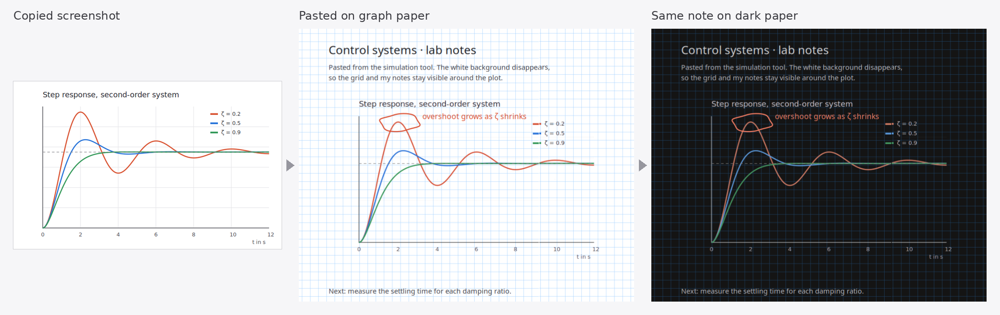
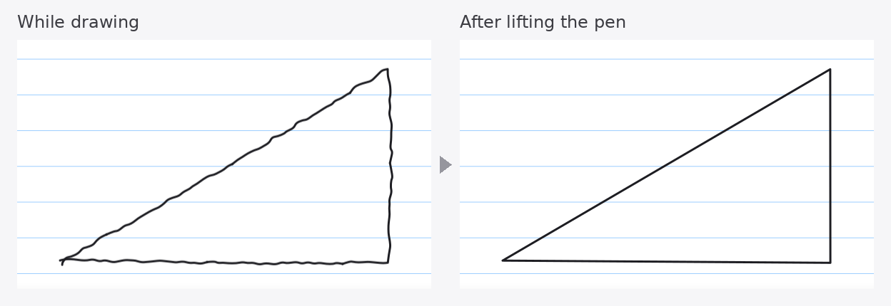
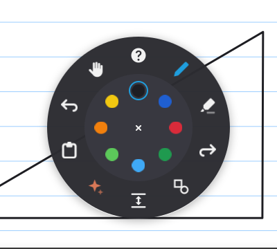
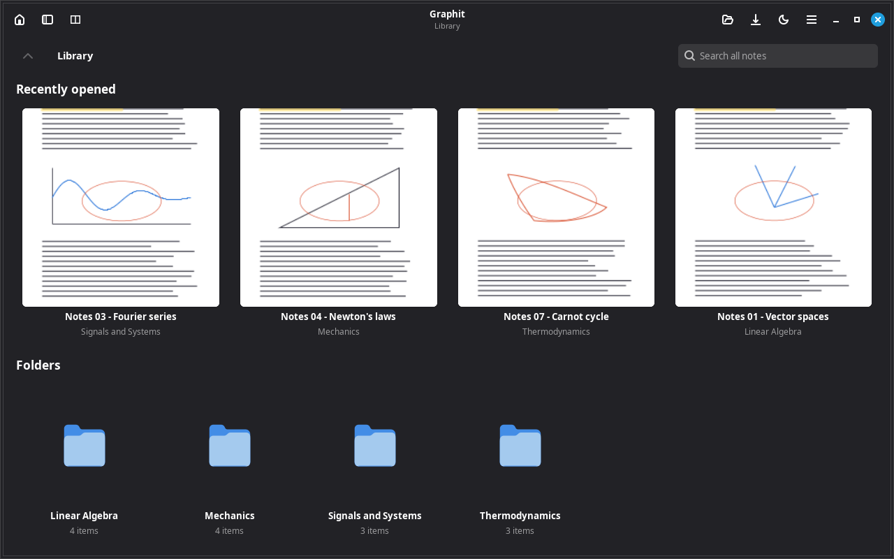
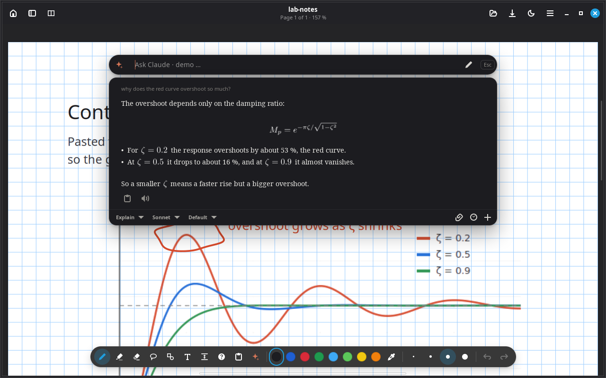

<h1 align="center">
  <br>
  Graphit
</h1>

<p align="center">
  <strong>Pen-first note-taking for Linux tablets and convertibles.</strong><br>
  Handwriting, PDF annotation and Xournal++ files, in a fast native GTK4 app.
</p>

<p align="center">
  <a href="https://github.com/LaserFocus007/graphit/releases/latest"></a>
  <a href="LICENSE"></a>
  
  
</p>

<p align="center">
  
</p>

Graphit opens your existing Xournal++ notebooks and PDFs, keeps up with the pen and stays out of the way while you write. Rendering runs on the GPU, so scrolling and zooming stay smooth even in long lecture scripts. An optional study companion built on [Claude Code](https://claude.com/claude-code) can explain your notes right on the page.

## Features

**Writing**
- Low-latency ink with stroke prediction, pressure curves, pressure calibration and optional pencil-style tilt shading
- Hold the pen still to straighten a line, or let rough sketches snap into clean lines, circles, rectangles and triangles
- Shape tool with lines, arrows, rectangles and ellipses
- Highlighter that snaps to the text lines of a PDF
- Lasso selection, text boxes, images, an insert-space tool and an eyedropper

**Pen and touch**
- Palm rejection: rest your hand on the screen while fingers pan and zoom, with smooth kinetic scrolling
- Radial menu right at the pen tip for tools, colors, undo and paste
- Configurable pen buttons and eraser end

**Screenshots that fit the page**
- Pasted screenshots lose their white or black background, so the paper and your notes show through
- On dark paper they are recolored to match, while photos keep their colors

**Documents**
- Opens and saves Xournal++ `.xopp` files as they are, no conversion
- Annotate PDFs and export the result back to PDF
- Tabs, plus two reading panes for keeping a script next to your notes
- Page sidebar with thumbnails for moving and deleting pages
- Graph, ruled, lined, dotted and plain paper, and dark paper for late nights
- Finds a background PDF again after you moved or renamed it

**Library**
- Folder-based start page with recent notes and page previews
- Search across all your notes, and find text inside the open document
- Remembers where you stopped reading in every file
- Opens files from GNOME Online Accounts such as Google Drive

## Screenshots

<p align="center">
  
</p>

<table>
  <tr>
    <td width="50%"></td>
    <td width="50%"></td>
  </tr>
  <tr>
    <td><strong>Shapes clean themselves up</strong> when you lift the pen.</td>
    <td><strong>Everything at the pen tip.</strong> Tools, colors, undo and paste without reaching for the toolbar.</td>
  </tr>
  <tr>
    <td width="50%"></td>
    <td width="50%"></td>
  </tr>
  <tr>
    <td><strong>A library of your folders</strong>, with previews and search across all notes.</td>
    <td><strong>Dark paper and reading panes</strong> for working with a script and your notes side by side.</td>
  </tr>
</table>

## Study companion

Press <kbd>Esc</kbd> and ask. Claude sees the page you are on and answers next to your work, with typeset formulas. Each course folder keeps its own conversation. This part is optional and needs [Claude Code](https://claude.com/claude-code) with your own account.

<p align="center">
  
</p>

- **Two window designs.** A classic chat window, or a focus design with a search bar and only the answer to your last question. Hold <kbd>Tab</kbd> to see through either one to the text underneath.
- **Ask any way you like.** Type, write the question with the pen, attach an image, or circle a spot on the page.
- **Walkthroughs that point.** Claude circles, underlines and frames the exact spot it explains, step by step. Formulas are taken apart term by term with colored boxes.
- **Lecture mode.** Pick basic understanding, deep theory, exam prep or a quick overview, and go through a script section by section. Steps can ask you to think first, and a simpler step appears when you get stuck.
- **Learn actively.** Quizzes, exercises with feedback on your own handwriting, and interactive plots with sliders. Shaky topics come back for review.
- **Writes into your notes.** Filled-in tables, formulas and sketches land on the page, undoable in one step.
- **Past exams and reading aloud.** Finds matching questions in your old exams, and reads answers with natural offline voices in English and German.

<table>
  <tr>
    <td width="50%"></td>
    <td width="50%"></td>
  </tr>
  <tr>
    <td width="50%"></td>
    <td width="50%"></td>
  </tr>
</table>

## Install

Graphit runs on Linux Mint 22, Ubuntu 24.04 and newer. Download the `.deb` from the [latest release](https://github.com/LaserFocus007/graphit/releases/latest), then run:

```sh
sudo apt install ./graphit_*_amd64.deb
```

On first launch, choose your notes folder. The interface is available in English and German under **Settings → General**. Graphit tells you when a new release is out.

| Optional | What it needs |
|---|---|
| Study companion | [Claude Code](https://claude.com/claude-code), installed and signed in with your own account |
| Formulas in answers | `pdflatex` and `pandoc`, installed as recommended packages |
| Natural reading voice | **Settings → General → Read aloud → Install**, about 250 MB for English and German |

Graphit works fully as a note-taking app without any of these.

## Keyboard shortcuts

| Keys | Action |
|---|---|
| <kbd>P</kbd> <kbd>H</kbd> <kbd>E</kbd> <kbd>S</kbd> <kbd>R</kbd> <kbd>T</kbd> | Pen, highlighter, eraser, selection, shapes, text |
| <kbd>Space</kbd> | Pan the page |
| <kbd>Ctrl</kbd>+<kbd>L</kbd> / <kbd>Ctrl</kbd>+<kbd>F</kbd> | Library / find in document |
| <kbd>F8</kbd> / <kbd>F9</kbd> | Reading pane / page sidebar |
| <kbd>Ctrl</kbd>+<kbd>Shift</kbd>+<kbd>D</kbd> | Dark paper |
| <kbd>Ctrl</kbd>+<kbd>E</kbd> | Export as PDF |
| <kbd>Esc</kbd> | Open or close the study companion |
| Hold <kbd>Tab</kbd> | See through the companion window |
| <kbd>←</kbd> <kbd>→</kbd> | Previous and next walkthrough card |

## Privacy

Your notes stay on your computer. Graphit sends data in two cases only:

- When you use the study companion, Claude Code receives the context for that request under your own account.
- At most once a day, Graphit asks GitHub whether a newer release exists, which reveals your IP address to GitHub. Turn this off under **Settings → General**.

## Known limitations

- Packages are built for x86-64 Debian and Ubuntu based systems. Other distributions need a build from source.
- Graphit is developed and tested on a GNOME Wayland convertible. Other pens and desktops should work, but are tested less.

## Build from source

```sh
sudo apt install build-essential dpkg-dev libgtk-4-dev libadwaita-1-dev libpoppler-glib-dev
cargo build --release
./packaging/build-deb.sh
```

## License

[GPL-3.0](LICENSE). Graphit is an independent project and is not affiliated with Xournal++ or Anthropic.
