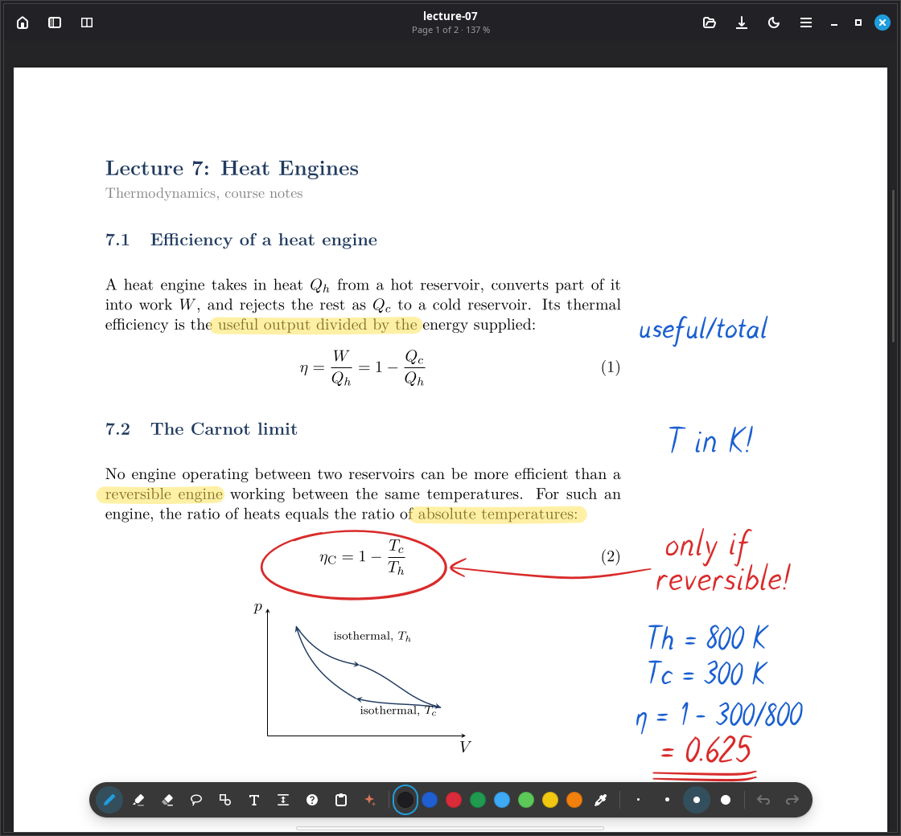
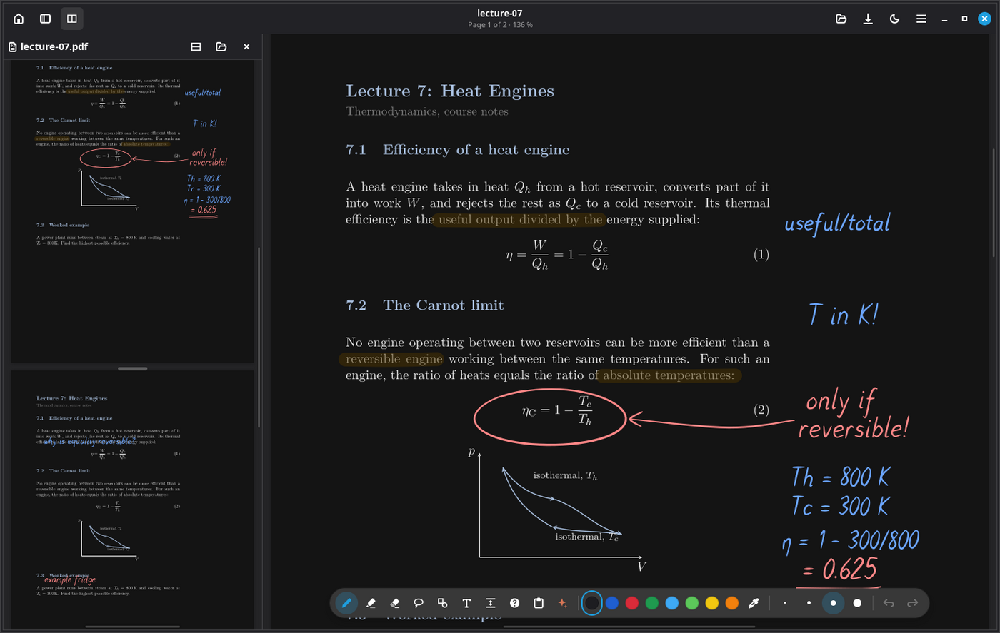
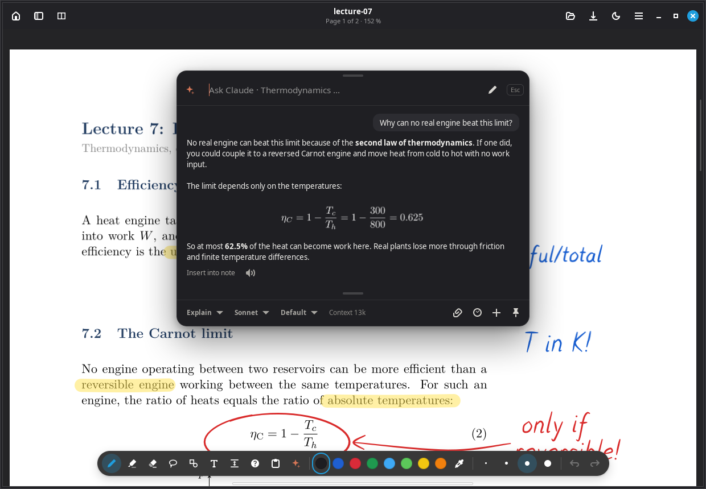
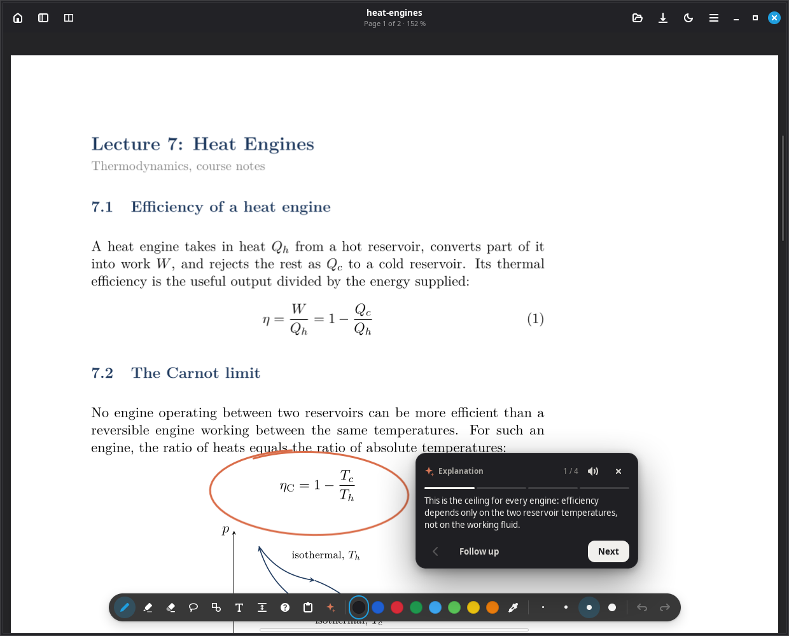
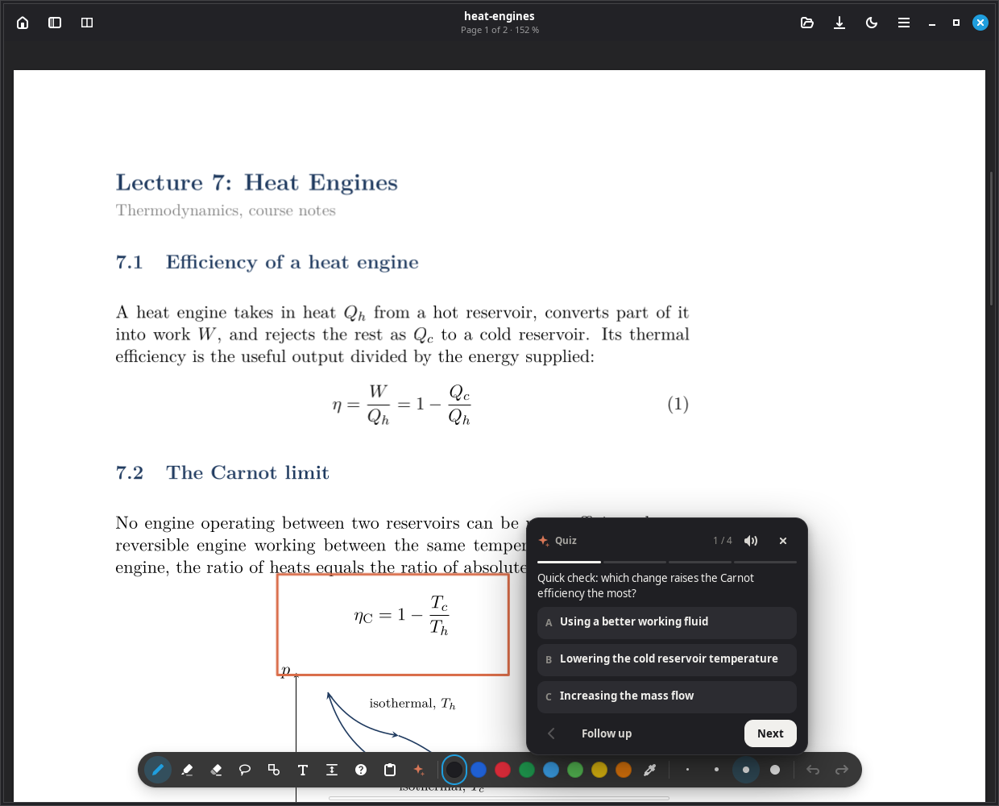
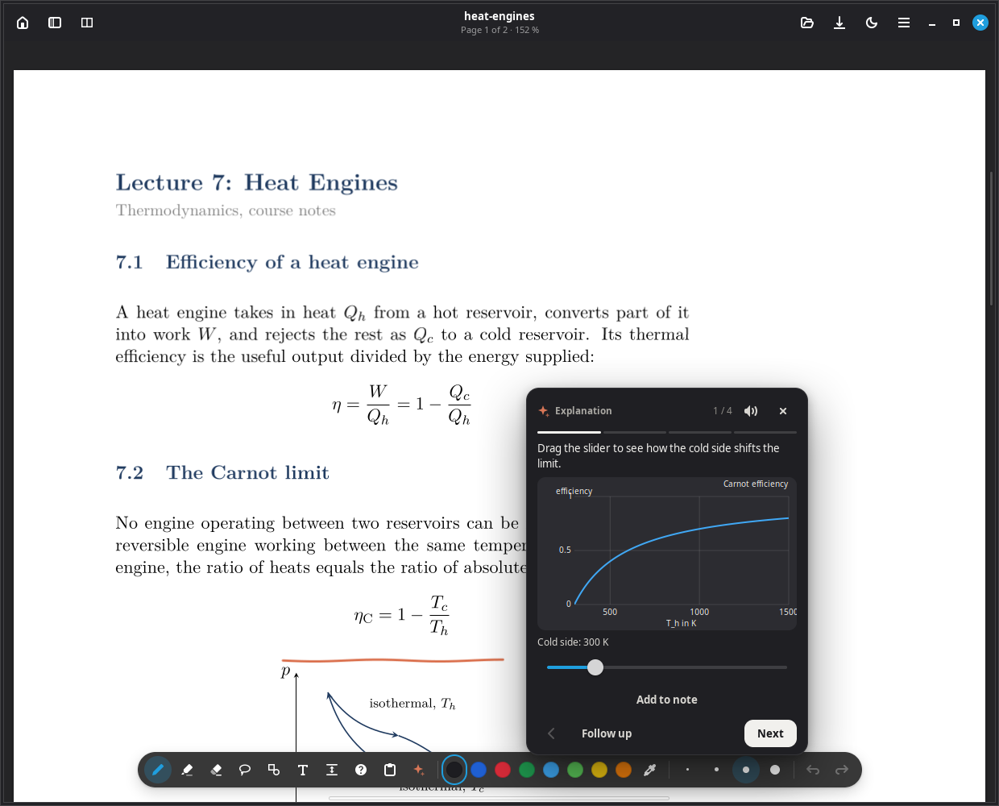

<h1 align="center">
  <br>
  Graphit
</h1>

<p align="center">
  <strong>Fast, pen-first note-taking for Linux, with a study companion that points at your page.</strong>
</p>

<p align="center">
  <a href="https://github.com/LaserFocus007/graphit/releases/latest"></a>
  <a href="LICENSE"></a>
  
  
</p>

<p align="center">
  
</p>

Graphit is a native handwriting app for Linux tablets and convertibles. It opens your existing Xournal++ notebooks, annotates PDFs and stays out of the way while you write. If you use [Claude Code](https://claude.com/claude-code), it can also explain your notes right on the page.

## Writing that keeps up

- **Low-latency ink** with stroke prediction, pressure curves, pressure calibration and optional pencil-style tilt shading.
- **Palm rejection** that lets your hand rest on the screen. Fingers pan and zoom, and only the pen writes.
- **Hold to straighten** a line, or let shapes clean themselves up when you lift the pen.
- **A radial menu at the pen tip** and configurable actions for pen buttons and the eraser end.
- **Lasso selection**, text, images, insert-space tool and a highlighter that snaps to PDF text lines.

## Your documents, as they are

- **Compatible with Xournal++.** Open and save `.xopp` files without converting anything.
- **PDF annotation** with export back to PDF.
- **Tabs and side-by-side readers**, so a script and your notes can stay open together.
- **Search across all your notes** from a folder-based library.
- **Dark paper** for late-night sessions, and page tools for inserting, reordering and changing paper styles.

<p align="center">
  
</p>

## A study companion on the page

Press <kbd>Esc</kbd> and ask. Claude sees the page you are on and answers next to your work, with typeset formulas. Each course folder keeps its own conversation.

<table>
  <tr>
    <td width="50%"></td>
    <td width="50%"></td>
  </tr>
  <tr>
    <td><strong>Ask about anything on the page.</strong> Type, write with the pen, attach an image or circle a spot.</td>
    <td><strong>Walkthroughs that point.</strong> Claude circles and underlines the exact spot it is talking about, step by step.</td>
  </tr>
  <tr>
    <td width="50%"></td>
    <td width="50%"></td>
  </tr>
  <tr>
    <td><strong>Learn actively.</strong> Quizzes, exercises and hints check your understanding, and shaky topics come back for review.</td>
    <td><strong>Play with the formula.</strong> Interactive plots with sliders show how each quantity changes the result.</td>
  </tr>
</table>

Claude can also write into your notes, fill in tables and add formulas, all undoable in one step. It can walk through a lecture section by section, find matching questions in your past exams and read explanations aloud.

## Install

Graphit runs on Linux Mint 22, Ubuntu 24.04 and newer. Download the `.deb` from the [latest release](https://github.com/LaserFocus007/graphit/releases/latest), then run:

```sh
sudo apt install ./graphit_*_amd64.deb
```

On first launch, choose your notes folder. The interface is available in English and German under **Settings → General**.

### Optional helpers

| Feature | Needs |
|---|---|
| AI features | [Claude Code](https://claude.com/claude-code), installed and signed in with your own account |
| Formulas in answers | `pdflatex` and `pandoc`, installed as recommended packages |
| Natural reading voice | Settings → General → Read aloud → Install, or run `/usr/share/graphit/install-voice.sh`. About 250 MB for English and German |

Graphit works fully as a note-taking app without any of these.

## Privacy

Your notes stay on your computer. Graphit sends data in two cases only:

- When you use an AI feature, Claude Code receives the context for that request under your own account.
- At most once a day, Graphit asks GitHub whether a newer release exists, which reveals your IP address to GitHub. Turn this off under **Settings → General**.

## Build from source

```sh
sudo apt install build-essential dpkg-dev libgtk-4-dev libadwaita-1-dev libpoppler-glib-dev
cargo build --release
./packaging/build-deb.sh
```

## License

[GPL-3.0](LICENSE). Graphit is an independent project and is not affiliated with Xournal++ or Anthropic.
